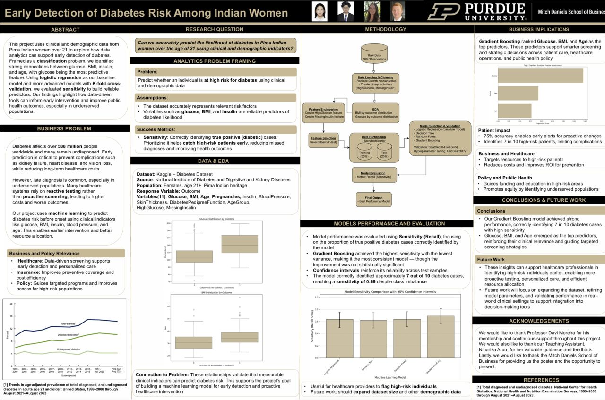

# Early Detection of Diabetes Risk Among Pima Indian Women

**Distinction Award, 2025 Fall Undergraduate Research Expo, Purdue University**

## Research question

Can we accurately predict the likelihood of diabetes in Pima Indian women over the age of 21 using clinical and demographic indicators?

## Why it matters

Diabetes affects over 588 million people worldwide, and many cases go undiagnosed. Early prediction can help prevent complications and reduce long-term healthcare costs, especially in underserved populations where diagnosis often comes late.

## Data

- **Source:** Kaggle Diabetes Dataset, originally from the National Institute of Diabetes and Digestive and Kidney Diseases
- **Size:** 768 records
- **Population:** Women aged 21 and over of Pima Indian heritage
- **Variables:** 11, including glucose, BMI, age, pregnancies, insulin and blood pressure

## Method

1. Cleaned the data, replacing zero values with the median and adding indicators for high glucose and missing insulin.
2. Explored how glucose and BMI differ between people with and without diabetes.
3. Selected features and split the data into 80% training and 20% test sets.
4. Compared four models: logistic regression as a baseline, a decision tree, a random forest and gradient boosting.
5. Validated with stratified 5-fold cross-validation and tuned settings with a grid search.

We measured success by **sensitivity**, the share of actual diabetes cases the model catches. Missing a high-risk patient is the costliest mistake.

## Results

- Gradient boosting had the highest sensitivity, **0.69**, correctly identifying about 7 in 10 diabetes cases. It also had the lowest variance, though its improvement over the other models wasn't statistically significant.
- **Glucose, BMI and age** were the strongest predictors.

## Business implications

- **Healthcare:** helps target screening and resources toward high-risk patients.
- **Insurance:** supports preventive coverage and cost efficiency.
- **Public policy:** guides funding and education toward high-risk areas.

## Future work

Expand the dataset, refine model settings and validate the model in real-world clinical settings.

[Back to Brayden Zink's portfolio](../README.md)
