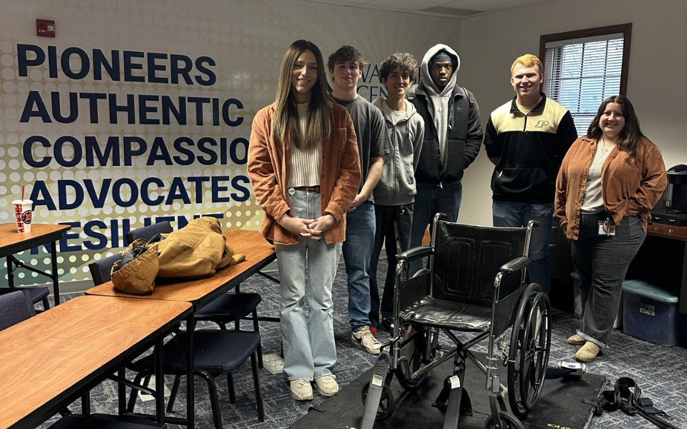

# EPICS NABL: Wheelchair Training Platform

| | |
|---|---|
| **Program** | Purdue EPICS (Engineering Projects in Community Service) |
| **Community partner** | Grant's House, Lafayette, Indiana |
| **My role** | Team leader of a multidisciplinary team |
| **When** | Fall 2025 |
| **Process** | EPICS Design Process |

## The problem

Grant's House trains new employees to secure children who use wheelchairs in a van. Training inside the van was cramped, so only a few people could learn at a time.

## The solution

The platform simulates securing a child in a van, using the same tie-down straps. New employees can now train in an open room, with many people learning the process together.

## My role

Our team took over the project midway through its lifecycle from a previous EPICS team. I led the team through the rest of the design and development work, and we completed the platform by the end of the semester.

## The challenge

Taking over midway meant learning and understanding all of the information and specifications the previous team had produced. It took time to get up to speed, but we persevered and finished on schedule.

## Result

The platform was delivered to Grant's House, and they now use it to train new employees.

[Back to Brayden Zink's portfolio](../README.md)
