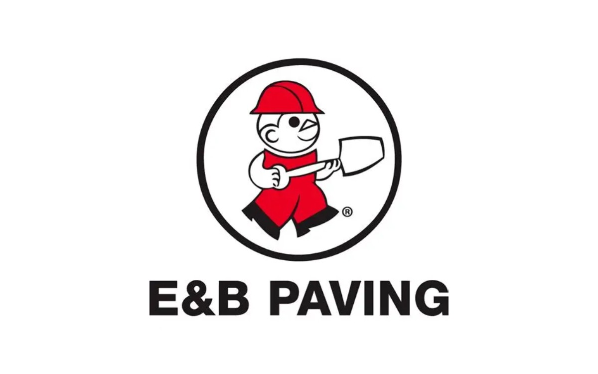

# US 31 Kokomo Bypass Concrete Patch Job (R-43541)

| | |
|---|---|
| **Company** | E&B Paving |
| **Client** | Indiana Department of Transportation (INDOT) |
| **My roles** | Survey Engineering and Project Management Intern (summer 2025) Project Management Intern (summer 2026) |
| **Tools** | HeavyJob, HeavyBid, Vista, OnBase, Google Sheets |

## The project

A 13-mile concrete patching job on the US 31 bypass around Kokomo, Indiana.

## What I did

### Summer 2025: field work

- Helped pour the concrete patches.
- Tined the concrete after it was poured.

### Summer 2026: project management

- Developed job cost breakdowns for INDOT.
- Built forecasting spreadsheets to track and predict the job's costs.
- Monitored resource allocation for the job.

## Result

My cost breakdowns and forecasts helped E&B Paving and INDOT track and predict the job's costs.

## What I learned

Working on the job from both the field and the office side, I learned the day-to-day tasks that project managers handle. I also saw how they managed every interaction as the person in charge of the job.

---

Company cost figures and internal documents aren't included here because they're confidential.

[Back to Brayden Zink's portfolio](../README.md)
